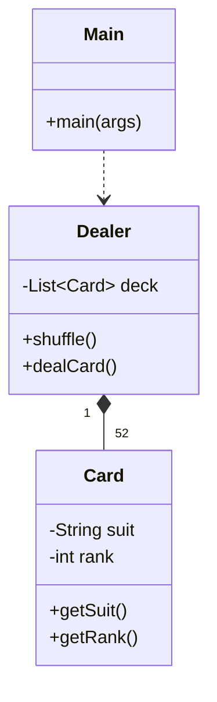

<p align="center">
  
</p>

<p align="center">
    
</p>


## 📌 Table of Contents
- [📖 Executive Summary](#-executive-summary)
- [✨ Key Features & Capabilities](#-key-features--capabilities)
- [🏗️ System Architecture & Workflow](#️-system-architecture--workflow)
- [🛠️ Tech Stack Breakdown](#️-tech-stack-breakdown)
- [⚙️ Reproducible Quickstart & Setup](#️-reproducible-quickstart--setup)
- [📂 Project Directory Layout](#-project-directory-layout)
- [👩‍💻 Author & Contributions](#-author--contributions)

---

## 📖 Executive Summary
### Problem Statement
Simulating multi-player card games requires clean separation of concerns between deck manipulation, card state encapsulation, and dealer shuffle/deal mechanics.

### Motivation & Solution Overview
An Object-Oriented Java simulation modeling card decks, dealers, and game distribution rules alongside verified UML structural object diagrams.

---

## ✨ Key Features & Capabilities
- **Modular Card State:** Models suits, ranks, and numerical values with encapsulation.
- **Dealer Engine:** Manages card shuffling, randomized dealing, and hand distribution.
- **Architectural Diagram:** Object-level visual specification included in repository.

---

## 🏗️ System Architecture & Workflow


---

## 🛠️ Tech Stack Breakdown
| Category | Technologies |
|---|---|
| **Language** | Java (JDK 8+) |
| **Paradigm** | Object-Oriented Programming (OOP) |
| **Documentation** | UML Object Diagram (`object level diagram-card.jpg`) |

---

## ⚙️ Reproducible Quickstart & Setup
### Compilation and Execution
```bash
git clone https://github.com/Bhumikaravi/cardgame-repo.git
cd cardgame-repo
javac *.java
java Main
```

---

## 📂 Project Directory Layout
```text
cardgame-repo/
├── Card.java
├── Dealer.java
├── Main.java
├── object level diagram-card.jpg
└── README.md
```

---

## 👩‍💻 Author & Contributions
Developed by **Bhumika Ravi** ([@Bhumikaravi](https://github.com/Bhumikaravi)), Bachelor of Computer Applications (BCA) at **Alliance University, Bengaluru**.

- 💻 **GitHub Profile:** [github.com/Bhumikaravi](https://github.com/Bhumikaravi)
- 🔗 **LinkedIn:** [linkedin.com/in/bhumika-ravi-b5a01b326](https://www.linkedin.com/in/bhumika-ravi-b5a01b326/)
- 📬 **Email Contact:** [bhumikaravi2006@gmail.com](mailto:bhumikaravi2006@gmail.com)

---

<p align="center">
  
</p>
